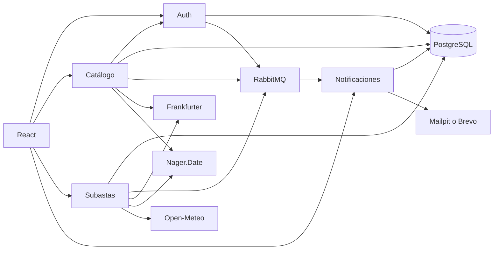

# VÉRTICE · Piezas singulares y subastas curadas

Casa de subastas editorial con 18 piezas ilustrativas. Las vitrinas reúnen moda de autor, relojería, joyería, arte y colección, y vehículos de exhibición. Cada lote tiene fotografía propia, atributos y un motivo curatorial. Los pagos, las entregas, las procedencias y los traspasos son simulados.

La portada usa el tema claro del kit Cúspide v2. Presenta cuatro cierres próximos, tres lanzamientos y siete categorías con el conteo de lotes activos. Tienda reúne objetos de autor, joyería, accesorios y piezas de colección. El inventario histórico de tecnología y de comercio general queda archivado para conservar sus pedidos. Auth, Catálogo, Subastas y Notificaciones mantienen cuatro servicios hexagonales. El POM de la raíz permite importar los cuatro en IntelliJ IDEA.

[Guion y pasos de sustentación](docs/Sustentacion-Vertice.md) · [Modelo entidad-relación](docs/pgadmin/vertice-mer.md) · [Evidencias de la corrida](REVISION_FINAL.md) · [Portada actual](docs/capturas/vertice-curado-portada.png) · [Tienda actual](docs/capturas/vertice-curado-tienda.png)

## Arranque en Windows

```powershell
powershell -ExecutionPolicy Bypass -File .\iniciar.ps1
powershell -ExecutionPolicy Bypass -File .\detener.ps1
```

El inicio prepara la base, verifica la salud de las APIs y abre la tienda, Mailpit, Swagger y pgAdmin si está instalado. Para cerrar el entorno se usa el segundo comando. Los datos se conservan. Si falla un servicio, revisa sus archivos `.log` y `.err.log` en `%LOCALAPPDATA%\EcommerceDev`. [Instrucciones de arranque](Instrucciones%20de%20arranque.md)

| Componente | Puerto local | Abrir |
| --- | ---: | --- |
| React | 3000 | [Tienda](http://localhost:3000) |
| Auth | 9090 | [Swagger](http://localhost:9090/swagger-ui.html) |
| Catálogo | 9092 | [Swagger](http://localhost:9092/swagger-ui.html) |
| Notificaciones | 9093 | [Swagger](http://localhost:9093/swagger-ui.html) |
| Subastas | 9094 | [Swagger](http://localhost:9094/swagger-ui.html) |
| PostgreSQL | 55432 | pgAdmin |
| RabbitMQ | 5673 | Health de Notificaciones |
| Mailpit | 8025 web / 1025 SMTP | [Bandeja](http://localhost:8025) |

## Actividad y pagos simulados

Abre **Mi cuenta → Actividad**. Pujas muestra el historial, Subastas ganadas reúne las adjudicaciones y Compras conserva los pedidos y su inventario confirmado. Ambas modalidades muestran el importe en COP, la referencia de pago y el estado Pendiente o Pagado. Cuando hay una tasa válida, aparece la referencia aproximada de Frankfurter.

La compra nueva descuenta el stock al confirmar el pedido. Su pago simulado se registra desde la cuenta y conserva la primera fecha al repetirse. La adjudicación registra el pago con la misma interacción. Los pedidos históricos conservan sus datos y estados. Se excluyen de la búsqueda, los conteos y las vitrinas los nombres reservados de QA, k6 y ensayo. El acceso por identificador conserva la trazabilidad de pruebas e historiales.

En un lanzamiento, Catálogo bloquea la edición al validar apertura, cupo por cliente y stock. En Subastas, el cierre exige la reserva cuando se configuró y el pago registra un aviso único en su bandeja de salida. La referencia identifica una operación de pago por orden. La serie de cada lanzamiento se presenta como parte de su ficha.

Los pagos, la entrega y el traspaso son de demostración académica. El sistema no solicita tarjetas ni contacta proveedores de pago.

## Recorrido de compra

Explora sin cuenta. Filtra por categoría, marca, condición o precio. La ficha reúne galería, compatibilidad, especificaciones, garantía y la nota de estado para usados. Regístrate, agrega un producto al carrito, confirma el pedido y abre **Compras** en la actividad para completar el pago. En Mailpit busca el correo con el número del pedido.

El catálogo, la ficha y el carrito muestran el stock actual y lo consultan al volver a la pestaña. Si otra persona compra la última unidad, el artículo queda agotado y se bloquea la confirmación del carrito hasta ajustar sus cantidades. El servidor comprueba el stock y registra una sola compra por carrito, incluso con dos confirmaciones simultáneas.

Los precios del seed se expresan en COP. Las imágenes locales son ilustrativas y las notas de usados describen ejemplos de grado y comprobaciones. Las fotografías no identifican unidades físicas. [Ejemplos de precios de periféricos en Colombia](https://www.alkosto.com/accesorios-electronica/accesorios-computadores/perifericos/webcam/c/BI_A46_ALKOS)

## Arquitectura y datos

Las operaciones públicas conservan sus contratos JSON y rutas de OpenAPI. La compra y la puja validan montos y reglas con HTTP 400, las rutas privadas requieren JWT y una orden ajena devuelve 404. Los instantes de pago y cierre se intercambian en UTC. React los presenta en `es-CO` con la zona del navegador. [Modelo de datos](docs/pgadmin/vertice-mer.md) · [Créditos](docs/CREDITOS_IMAGENES.md)



## Recorrido de subasta

Abre **Subastas** y filtra por nombre, categoría, condición o rango de precio. En la ficha puedes consultar la puja mínima y el historial anonimizado. Con una cuenta inicia una puja. Si otra cuenta ofrece un monto superior, el primer postor recibe un correo. Cada oferta aceptada en los últimos 2 minutos extiende el cierre otros 2 minutos. En **Mis pujas** se muestran las ofertas propias y las adjudicaciones. El ganador confirma un pago simulado. Las fotos locales son ilustrativas y los vehículos y joyas son lotes ficticios. El seed actual incorpora 18 piezas. Los lotes de demostración anteriores con pujas se conservan para su historial.

Las rutas se agrupan bajo `/api/ecommerce/subastas`.

| API | Lógica |
| --- | --- |
| `POST /` | Crea un lote con fecha válida y calcula su estado inicial. Requiere administrador. |
| `GET /` | Aplica filtros, orden de cierre y paginación del servidor. |
| `GET /{id}` | Incluye historial anonimizado, puja mínima y adjudicación según la sesión. |
| `POST /{id}/pujas` | Valida plazo y monto, actualiza precio de forma atómica y registra historial. |
| `GET /mias` | Agrupa las ofertas propias y las adjudicaciones. |
| `POST /{id}/cancelar` | Valida el estado y plazo antes de cancelar. Requiere administrador. |
| `POST /{id}/pago` | Confirma el pago del ganador. Repetirlo conserva el mismo resultado. |

Bajo concurrencia, PostgreSQL bloquea la fila del lote y el `UPDATE` comprueba la versión. La misma transacción guarda el historial y los avisos. Un proceso separado confirma la publicación en RabbitMQ. Notificaciones conserva sus reintentos y la cola de errores y entrega por SMTP. La publicación ofrece entrega al menos una vez. Una caída entre la confirmación y el registro en PostgreSQL puede repetir el correo.

[Captura del listado](docs/capturas/subastas-lista-1440.png) · [Adjudicación local](docs/capturas/subastas-adjudicada.png) · [Correo en Mailpit](docs/capturas/subastas-correo-ganada.png) · [Guía de Neon y pgAdmin](docs/pgadmin/README.md)

La [revisión de entrega](REVISION_FINAL.md) reúne cobertura, Newman, k6 y capturas. La [guía PDF](output/pdf/editorial/guia-vertice.pdf) resume la explicación y el arranque. Las dos ediciones IEEE se pueden recompilar desde [docs/articulo](docs/articulo).

Auth valida credenciales y emite JWT. Catálogo administra productos, carrito e inventario de pedidos. Notificaciones entrega correos de registro, compra y estado. El consumidor tiene reintentos y cola de errores. El envío después del commit evita revertir el pedido si falla el aviso.

La migración y el seed se ejecutan al iniciar Catálogo. La clave única `sku_demo` evita duplicados. Los productos históricos retirados quedan archivados para conservar los pedidos ya registrados.


En pgAdmin usa host `127.0.0.1`, puerto `55432`, base `ecommerce` y usuario `ecommerce_dev`. Obtén la contraseña de `POSTGRES_PASSWORD` en `.env.native`. [Guía de pgAdmin y consultas SQL](docs/pgadmin/README.md)

## Cinco APIs no CRUD por microservicio

| Servicio | Operaciones |
| --- | --- |
| Auth | `POST /login` emite JWT, `GET /sesion` comprueba la cuenta activa, `POST /evaluar-clave` revisa la política, `POST /renovar` emite otro JWT y `POST /cambiar-clave` verifica y gira la credencial. Prefijo `/api/ecommerce/usuario`. |
| Catálogo | `GET /producto/explorar` filtra y pagina, `GET /producto/{id}/precio-usd` convierte moneda, `GET /producto/entrega` estima días hábiles, `GET /carrito/resumen` calcula totales y `POST /compras/realizar` aplica inventario y registra el pedido. Prefijo `/api/ecommerce`. |
| Notificaciones | `POST /validar` revisa el mensaje, `POST /previsualizar/bienvenida` y `POST /previsualizar/compra` renderizan correos, `GET /plan-reintentos` devuelve esperas y `POST /encolar` acepta y guarda el aviso con clave de servicio. Prefijo `/api/ecommerce/notificaciones`. |
| Subastas | `POST /{id}/pujas` valida y registra ofertas, `GET /mias` reúne actividad propia, `POST /{id}/cancelar` valida el cierre anticipado y `POST /{id}/pago` liquida la adjudicación. Prefijo `/api/ecommerce/subastas`. Además, `GET /api/subastas/lote/{id}/precio-usd` calcula la referencia en dólares. |

| Proveedor | Dónde se usa | Vigencia y fallback |
| --- | --- | --- |
| [Frankfurter](https://frankfurter.dev/) | USD en la ficha de Tienda y de Subastas. Historial de pujas con la tasa vigente. | 6 h. Catálogo responde 503 sin tasa válida. Subastas devuelve `disponible:false`. |
| [Open-Meteo](https://open-meteo.com/en/docs) | Temperatura, humedad y precipitación actuales de la sede simulada en Bogotá. | 45 min. Sin observación vigente, la ficha indica que el dato no está disponible. |
| [Nager.Date](https://date.nager.at/) | Entrega del carrito, ficha de lote y adjudicación. | 24 h por año. Sin calendario vigente se calcula con lunes a viernes y se indica «Calendario parcial». |

Los dos servicios consultan en segundo plano con 1 s de conexión, 2 s de lectura, un reintento y un cortacircuito de 60 s tras tres fallos consecutivos. El precio en COP, la compra y la puja conservan su funcionamiento.

`GET /api/ecommerce/inicio` y `GET /api/subastas/inicio` alimentan la portada con caché de 30 y 15 segundos. La cuenta expone perfil en `/api/auth/perfil` y avisos paginados de la identidad firmada en `/api/notificaciones/mis-avisos`. Las fichas cruzan enlaces a la misma categoría principal. La conversión de una subasta desierta en una venta directa se deja para una fase futura.

Para verlas en la tienda, abre cualquier ficha y mira la **referencia en USD** debajo del precio en pesos. Luego agrega un producto y abre el **carrito**. El resumen muestra la **fecha estimada** para tres días hábiles con el calendario colombiano. Si una consulta falla, el precio en COP y la confirmación de compra siguen disponibles.

## Seguridad y notificaciones

**Cambiar contraseña** está en el menú de la cuenta. Auth exige la clave anterior y limita los intentos repetidos de login. Las contraseñas nuevas usan Argon2id. Los servicios validan el JWT con `JWT_SECRET`, compartido por entorno.

El correo de Windows se puede verificar en Mailpit. Para Brevo se configuran `MAIL_HOST`, `MAIL_PORT`, `MAIL_USERNAME`, `MAIL_PASSWORD`, `MAIL_FROM`, `MAIL_SMTP_AUTH` y `MAIL_STARTTLS`. Si faltan credenciales en modo autenticado, Notificaciones lo avisa y los correos pasan por el mecanismo de reintentos. Render Free usa el puerto alternativo 2525 con STARTTLS. [Pasos de Render](docs/Render.md)

## Postman y rendimiento

Importa la colección y elige **Local**. Guarda credenciales administrativas y claves solo como valores locales del entorno. El script de Newman crea la cuenta administrativa temporal y conserva un reporte sin cuerpos ni cabeceras. [Colección, entornos e informe](postman/README.md)

La galería editorial comprobó 52 rutas k6. Los máximos con 3, 6 y 8 usuarios fueron 4360,50 / 3268,34 / 1056,74 ms. Newman hizo 90 peticiones y 269 aserciones, con 11 fallos. JaCoCo en unitarias 20,29 / 33,14 / 68,85 / 16,08 % y suite conjunta 82,99 / 85,71 / 82,62 / 89,28 %, en orden Auth, Catálogo, Notificaciones y Subastas. [Rendimiento por ruta](resultados/vertice-curado-rendimiento.md)

### Mediciones anteriores a la galería editorial

La galería editorial comprobó 54 rutas k6. Los máximos con 3, 6 y 8 usuarios fueron 1139,82 / 1359,34 / 1270,45 ms. Newman hizo 93 peticiones y 278 aserciones, con 6 fallos. JaCoCo en unitarias 20,29 / 32,71 / 68,85 / 16,08 % y suite conjunta 82,99 / 84,77 / 82,62 / 88,81 %, en orden Auth, Catálogo, Notificaciones y Subastas. [Rendimiento por ruta](resultados/vertice-editorial-rendimiento.md)

### Mediciones anteriores a la galería editorial

La galería editorial verificó la compra 2938 y la adjudicación 41 del lote 661, con confirmaciones en Mailpit. Newman midió 88 peticiones, 0 aserciones fallidas de 263 y máximo 266,00 ms. En k6, los máximos fueron 3 VU 417,65 ms, 6 VU 2404,86 ms, 8 VU 2494,37 ms. La cobertura de líneas unitarias fue 20,04 / 34,56 / 68,61 / 16,90 % y con integración 82,44 / 86,97 / 81,88 / 92,14 %, en orden Auth, Catálogo, Notificaciones y Subastas. [Medición actual por ruta](resultados/vertice-galeria-rendimiento.md) · [Auditoría](docs/Auditoria.md)

### Mediciones anteriores a la galería

La corrida VÉRTICE ejercitó 50 rutas con 3, 6 y 8 usuarios virtuales. Los máximos fueron 878,79, 944,28 y 918,93 ms. Newman ejecutó 87 peticiones y 259 aserciones con seis fallos de latencia. JaCoCo superó el 80 % en los cuatro servicios al sumar integración. En unitarias aisladas el mejor resultado fue 68,61 %. [Latencias por ruta](resultados/vertice-rendimiento.md) · [Cobertura por servicio](resultados/vertice-cobertura.json) · [Auditoría](docs/Auditoria.md)

### Mediciones anteriores a VÉRTICE

<!-- RESULTADOS TECHSTORE -->
Pasaron **76 pruebas Java** y **12 React**. JaCoCo de líneas en la suite Java completa: **Auth 85,28 %, Catálogo 88,49 %, Notificaciones 82,95 %**.

Como antecedente, el pedido #2151 de Portátil ThinkPad T480 por 850.000 COP se confirmó en el navegador y se encontró el correo correspondiente en Mailpit.

Newman ejecutó 48 peticiones y 145 aserciones. Hubo 0 aserciones fallidas en la corrida de revisión, con máximo 194,00 ms. En la primera corrida de la revisión hubo 2 fallos de tiempo y un máximo de 1354,00 ms.

| Usuarios | Promedio ms | p95 ms | p99 ms | Máximo ms | Errores | Peticiones | req/s |
| ---: | ---: | ---: | ---: | ---: | ---: | ---: | ---: |
| 3 | 29,01 | 124,80 | 218,55 | 344,08 | 0 | 1665 | 61,16 |
| 6 | 23,84 | 114,04 | 211,19 | 284,96 | 0 | 3996 | 104,42 |
| 8 | 38,78 | 192,45 | 463,72 | 1086,76 | 0 | 3700 | 96,00 |

- **3 usuarios.** Rutas por encima de 500 ms: ninguna. Cambio de contraseña: máximo 257,77 ms y p95 247,55 ms.
- **6 usuarios.** Rutas por encima de 500 ms: ninguna. Cambio de contraseña: máximo 284,96 ms y p95 244,85 ms.
- **8 usuarios.** Rutas por encima de 500 ms: POST /save (861,08 ms), POST /login (591,87 ms), POST /renovar (629,82 ms), POST /cambiar-clave (1086,76 ms). Cambio de contraseña: máximo 1086,76 ms y p95 826,43 ms.
<!-- FIN RESULTADOS TECHSTORE -->

Para reproducir los perfiles usa `pruebas/ejecutar-k6.ps1` con el modo carga a 3 VU y el modo estrés a 6 y 8 VU. El máximo por ruta determina si se cumple el límite.

## Despliegue público

La demo de Windows incluye cuatro servicios. Para publicar, conecta Vercel a React, Render a los servicios Java, Neon a PostgreSQL, CloudAMQP a RabbitMQ y Brevo al correo. Los procesos gratuitos pueden suspenderse y el cron de subastas reanuda al despertar el servicio. El despliegue público requiere cuentas del propietario. [Guía de publicación](docs/Render.md)

## Guion de sustentación

1. Abre una ficha curada. Explica por qué es una subasta y muestra la puja mínima, la confirmación y el tiempo de cierre.
2. Muestra el lote 421 y su correo de adjudicación en Mailpit. Después enseña el stock y el historial de la compra 2772.
3. Abre Swagger, Postman y pgAdmin. Usa JaCoCo y k6 para explicar qué requisitos siguen pendientes. [Guion y preguntas](docs/Sustentacion-Vertice.md)

**¿Qué hace RabbitMQ?** Entrega el aviso por separado. El pedido se confirma en PostgreSQL y el correo se comprueba en Mailpit.

**¿Cómo evitas vender más unidades de las que hay?** La actualización de stock comprueba la cantidad en la misma escritura. Si algún artículo falla, el pedido completo se revierte.

**¿Por qué tarda el cambio de contraseña?** Verifica la credencial anterior y deriva otro hash. Las dos operaciones compiten por recursos bajo concurrencia.

[Guía PDF](output/pdf/editorial/guia-vertice.pdf) · [IEEE corto](output/pdf/editorial/articulo-ieee-4p.pdf) · [IEEE extendido](output/pdf/editorial/articulo-ieee.pdf) · [Auditoría](docs/Auditoria.md) · [Capturas](docs/capturas/)
