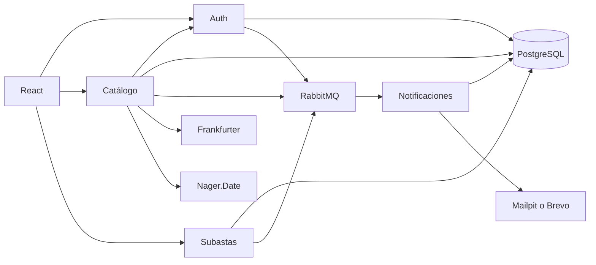
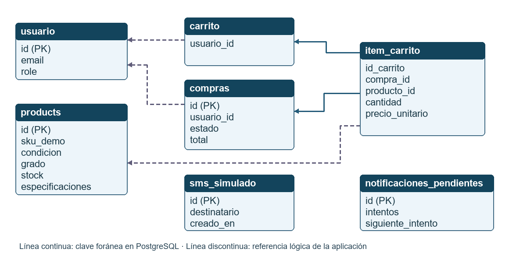

# TechStore

Tienda colombiana de computadores, componentes y electrónica nueva y usada, con subastas de ocho categorías. La tienda administra el inventario, publica los lotes y atiende los pedidos. El nombre del repositorio sigue siendo ECOMMERCE_FRANK.

## Arranque en Windows

```powershell
powershell -ExecutionPolicy Bypass -File .\iniciar.ps1
powershell -ExecutionPolicy Bypass -File .\detener.ps1
```

El inicio prepara la base, verifica la salud de las APIs y abre la tienda, Mailpit, Swagger y pgAdmin si está instalado. Para cerrar el entorno se usa el segundo comando. Los datos se conservan. Si falla un servicio, revisa sus archivos `.log` y `.err.log` en `%LOCALAPPDATA%\EcommerceDev`. [Instrucciones de arranque](Instrucciones%20de%20arranque.md)

| Componente | Puerto local | Abrir |
| --- | ---: | --- |
| React | 3000 | [Tienda](http://localhost:3000) |
| Auth | 9090 | [Swagger](http://localhost:9090/swagger-ui.html) |
| Catálogo | 9092 | [Swagger](http://localhost:9092/swagger-ui.html) |
| Notificaciones | 9093 | [Swagger](http://localhost:9093/swagger-ui.html) |
| Subastas | 9094 | [Swagger](http://localhost:9094/swagger-ui.html) |
| PostgreSQL | 55432 | pgAdmin |
| RabbitMQ | 5673 | Health de Notificaciones |
| Mailpit | 8025 web / 1025 SMTP | [Bandeja](http://localhost:8025) |

## Recorrido de compra

Explora sin cuenta. Filtra por categoría, marca, condición o precio. La ficha reúne galería, compatibilidad, especificaciones, garantía y la nota de estado para usados. Regístrate, agrega un producto al carrito, confirma la compra y abre **Mis compras**. En Mailpit busca el correo con el número del pedido.

El catálogo, la ficha y el carrito muestran el stock actual y lo consultan al volver a la pestaña. Si otra persona compra la última unidad, el artículo queda agotado y se bloquea la confirmación del carrito hasta ajustar sus cantidades. El servidor comprueba el stock y registra una sola compra por carrito, incluso con dos confirmaciones simultáneas.

Los precios del seed se expresan en COP. Las imágenes locales son ilustrativas y las notas de usados describen ejemplos de grado y comprobaciones. Las fotografías no identifican unidades físicas. [Ejemplos de precios de periféricos en Colombia](https://www.alkosto.com/accesorios-electronica/accesorios-computadores/perifericos/webcam/c/BI_A46_ALKOS)

## Arquitectura y datos



## Recorrido de subasta

Abre **Subastas** y filtra por nombre, categoría, condición o rango de precio. En la ficha puedes consultar la puja mínima y el historial anonimizado. Con una cuenta inicia una puja. Si otra cuenta ofrece un monto superior, el primer postor recibe un correo. Cada oferta aceptada en los últimos 2 minutos extiende el cierre otros 2 minutos. En **Mis pujas** se muestran las ofertas propias y las adjudicaciones. El ganador confirma un pago simulado. Las fotos locales son ilustrativas y los vehículos y joyas son lotes ficticios. Hay dos lotes por cada una de las ocho categorías.

Las rutas se agrupan bajo `/api/ecommerce/subastas`.

| API | Lógica |
| --- | --- |
| `POST /` | Crea un lote con fecha válida y calcula su estado inicial. Requiere administrador. |
| `GET /` | Aplica filtros, orden de cierre y paginación del servidor. |
| `GET /{id}` | Incluye historial anonimizado, puja mínima y adjudicación según la sesión. |
| `POST /{id}/pujas` | Valida plazo y monto, actualiza precio de forma atómica y registra historial. |
| `GET /mias` | Agrupa las ofertas propias y las adjudicaciones. |
| `POST /{id}/cancelar` | Valida el estado y plazo antes de cancelar. Requiere administrador. |
| `POST /{id}/pago` | Confirma el pago del ganador. Repetirlo conserva el mismo resultado. |

Bajo concurrencia, PostgreSQL bloquea la fila del lote y el `UPDATE` comprueba la versión. La misma transacción guarda el historial y los avisos. Un proceso separado confirma la publicación en RabbitMQ. Notificaciones conserva sus reintentos y la cola de errores y entrega por SMTP. La publicación ofrece entrega al menos una vez. Una caída entre la confirmación y el registro en PostgreSQL puede repetir el correo.

[Captura del listado](docs/capturas/subastas-lista-1440.png) · [Adjudicación local](docs/capturas/subastas-adjudicada.png) · [Correo en Mailpit](docs/capturas/subastas-correo-ganada.png) · [Guía de Neon y pgAdmin](docs/pgadmin/README.md)

La [revisión de entrega](REVISION_FINAL.md) reúne cobertura, Newman, k6 y capturas. La [guía PDF](output/pdf/guia-ecommerce-frank.pdf) resume la explicación y el arranque. Las dos ediciones IEEE se pueden recompilar desde [docs/articulo](docs/articulo).

Auth valida credenciales y emite JWT. Catálogo administra productos, carrito e inventario de pedidos. Notificaciones entrega correos de registro, compra y estado. El consumidor tiene reintentos y cola de errores. El envío después del commit evita revertir el pedido si falla el aviso.

La migración y el seed se ejecutan al iniciar Catálogo. La clave única `sku_demo` evita duplicados. Los productos históricos retirados quedan archivados para conservar los pedidos ya registrados.



En pgAdmin usa host `127.0.0.1`, puerto `55432`, base `ecommerce` y usuario `ecommerce_dev`. Obtén la contraseña de `POSTGRES_PASSWORD` en `.env.native`. [Guía de pgAdmin y consultas SQL](docs/pgadmin/README.md)

## Cinco APIs no CRUD por microservicio

| Servicio | Operaciones |
| --- | --- |
| Auth | `POST /login` emite JWT, `GET /sesion` comprueba la cuenta activa, `POST /evaluar-clave` revisa la política, `POST /renovar` emite otro JWT y `POST /cambiar-clave` verifica y gira la credencial. Prefijo `/api/ecommerce/usuario`. |
| Catálogo | `GET /producto/explorar` filtra y pagina, `GET /producto/{id}/precio-usd` convierte moneda, `GET /producto/entrega` estima días hábiles, `GET /carrito/resumen` calcula totales y `POST /compras/realizar` aplica inventario y registra el pedido. Prefijo `/api/ecommerce`. |
| Notificaciones | `POST /validar` revisa el mensaje, `POST /previsualizar/bienvenida` y `POST /previsualizar/compra` renderizan correos, `GET /plan-reintentos` devuelve esperas y `POST /encolar` acepta y guarda el aviso con clave de servicio. Prefijo `/api/ecommerce/notificaciones`. |

Frankfurter actualiza la tasa COP/USD en segundo plano. Sin una tasa vigente, la conversión devuelve 503. Nager.Date entrega festivos de Colombia. Si falta un año necesario, la fecha estimada indica que es parcial. Los dos adaptadores usan caché y límites de conexión y lectura de 2 s. [Frankfurter](https://frankfurter.dev/) · [Nager.Date](https://date.nager.at/)

Para verlas en la tienda, abre cualquier ficha y mira la **referencia en USD** debajo del precio en pesos. Luego agrega un producto y abre el **carrito**. El resumen muestra la **fecha estimada** para tres días hábiles con el calendario colombiano. Si una consulta falla, el precio en COP y la confirmación de compra siguen disponibles.

## Seguridad y notificaciones

**Cambiar contraseña** está en el menú de la cuenta. Auth exige la clave anterior y limita los intentos repetidos de login. Las contraseñas nuevas usan Argon2id. Los servicios validan el JWT con `JWT_SECRET`, compartido por entorno.

El correo de Windows se puede verificar en Mailpit. Para Brevo se configuran `MAIL_HOST`, `MAIL_PORT`, `MAIL_USERNAME`, `MAIL_PASSWORD`, `MAIL_FROM`, `MAIL_SMTP_AUTH` y `MAIL_STARTTLS`. Si faltan credenciales en modo autenticado, Notificaciones lo avisa y los correos pasan por el mecanismo de reintentos. Render Free usa el puerto alternativo 2525 con STARTTLS. [Pasos de Render](docs/Render.md)

## Postman y rendimiento

Importa la colección y elige **Local**. Guarda credenciales administrativas y claves solo como valores locales del entorno. El script de Newman crea la cuenta administrativa temporal y conserva un reporte sin cuerpos ni cabeceras. [Colección, entornos e informe](postman/README.md)

<!-- RESULTADOS TECHSTORE -->
Pasaron **76 pruebas Java** y **12 React**. JaCoCo de líneas en la suite Java completa: **Auth 85,28 %, Catálogo 88,49 %, Notificaciones 82,95 %**.

El pedido #2151 de Portátil ThinkPad T480 por 850.000 COP se confirmó en el navegador y se encontró el correo correspondiente en Mailpit.

Newman ejecutó 48 peticiones y 145 aserciones. Hubo 0 aserciones fallidas en la corrida de revisión, con máximo 194,00 ms. En la primera corrida de la revisión hubo 2 fallos de tiempo y un máximo de 1354,00 ms.

| Usuarios | Promedio ms | p95 ms | p99 ms | Máximo ms | Errores | Peticiones | req/s |
| ---: | ---: | ---: | ---: | ---: | ---: | ---: | ---: |
| 3 | 29,01 | 124,80 | 218,55 | 344,08 | 0 | 1665 | 61,16 |
| 6 | 23,84 | 114,04 | 211,19 | 284,96 | 0 | 3996 | 104,42 |
| 8 | 38,78 | 192,45 | 463,72 | 1086,76 | 0 | 3700 | 96,00 |

- **3 usuarios.** Rutas por encima de 500 ms: ninguna. Cambio de contraseña: máximo 257,77 ms y p95 247,55 ms.
- **6 usuarios.** Rutas por encima de 500 ms: ninguna. Cambio de contraseña: máximo 284,96 ms y p95 244,85 ms.
- **8 usuarios.** Rutas por encima de 500 ms: POST /save (861,08 ms), POST /login (591,87 ms), POST /renovar (629,82 ms), POST /cambiar-clave (1086,76 ms). Cambio de contraseña: máximo 1086,76 ms y p95 826,43 ms.
<!-- FIN RESULTADOS TECHSTORE -->

Para reproducir los perfiles usa `pruebas/ejecutar-k6.ps1` con modos carga y estrés. Cada perfil mide la aplicación en Windows. El máximo por ruta es el criterio para los 500 ms. [Informe por ruta](resultados/latencias-techstore.md)

## Despliegue público

La demo de Windows incluye cuatro servicios. Para publicar, conecta Vercel a React, Render a los servicios Java, Neon a PostgreSQL, CloudAMQP a RabbitMQ y Brevo al correo. Los procesos gratuitos pueden suspenderse y el cron de subastas reanuda al despertar el servicio. El despliegue público requiere cuentas del propietario. [Guía de publicación](docs/Render.md)

## Guion de sustentación

1. Abre la tienda. Busca un portátil usado por marca. Explica condición, grado, garantía y paginación.
2. Haz un registro y un pedido. Enseña carrito, historial, correo en Mailpit y tablas en pgAdmin.
3. Ejecuta Postman o abre el reporte HTML. Enseña Swagger, JaCoCo y una ruta que supere 500 ms.

**¿Qué hace RabbitMQ?** Entrega el aviso por separado. El pedido se confirma en PostgreSQL y el correo se comprueba en Mailpit.

**¿Cómo evitas vender más unidades de las que hay?** La actualización de stock comprueba la cantidad en la misma escritura. Si algún artículo falla, el pedido completo se revierte.

**¿Por qué tarda el cambio de contraseña?** Verifica la credencial anterior y deriva otro hash. Las dos operaciones compiten por recursos bajo concurrencia.

[Guía PDF](output/pdf/guia-ecommerce-frank.pdf) · [Artículo IEEE](output/pdf/articulo-ieee.pdf) · [Auditoría](docs/Auditoria.md) · [Capturas](docs/capturas/)
