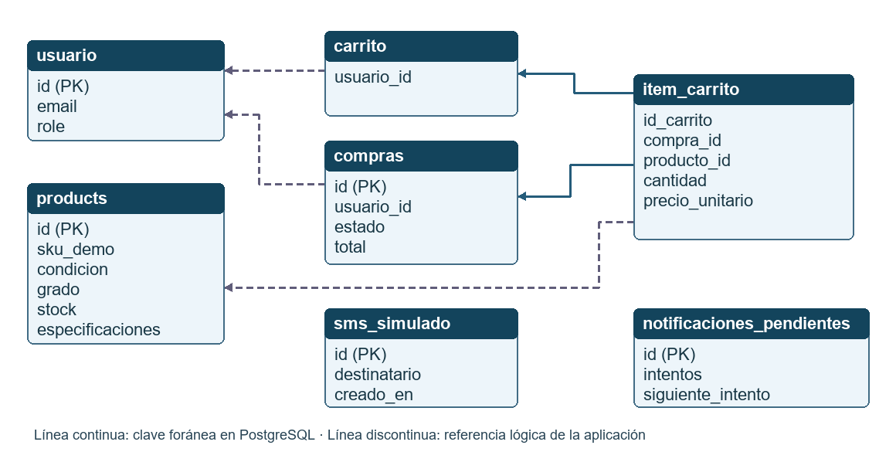
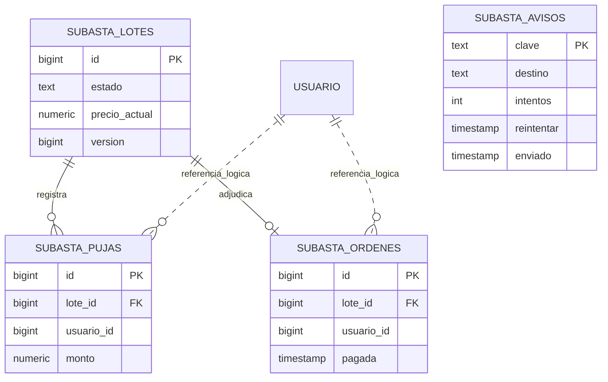

# Ver PostgreSQL y el diagrama de TechStore

1. Ejecuta `iniciar.ps1`. Abre pgAdmin 4 e importa [servers.json](servers.json) en **Tools → Import/Export Servers → Import**.
2. En **TechStore Local** conecta a `127.0.0.1:55432`, base `ecommerce` y usuario `ecommerce_dev`. La contraseña está en `POSTGRES_PASSWORD` de tu `.env.native`.
3. Abre **Databases → ecommerce → Schemas → public → Tables**. Ejecuta [verificacion.sql](verificacion.sql) en **Query Tool** con F5.
4. En **TechStore Neon → Properties → Connection**, usa el host directo de **Neon → Connect**, puerto 5432, base y rol del proyecto. Define **SSL mode = Require** y escribe la contraseña desde el panel Neon. Repite la consulta allí.
5. Los correos locales aparecen en [Mailpit](http://localhost:8025). `subasta_avisos` indica si RabbitMQ confirmó la publicación. `sms_simulado` muestra el registro local de mensajes de los flujos de compra.

Las cuatro tablas usan la misma base, bajo `public`. Los identificadores de Auth son referencias lógicas. La bandeja conserva el contenido necesario para publicar incluso si el envío se retrasa. Hibernate y SQL inicializan el esquema. Se deja la adopción de Flyway y un esquema por servicio para una migración futura con respaldo.