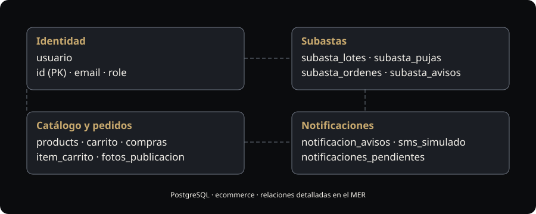
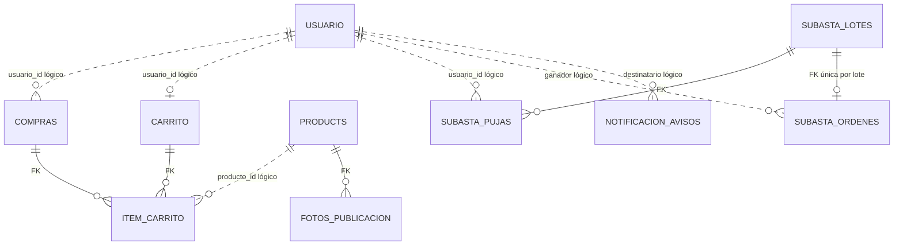

# Modelo de datos de VÉRTICE

PostgreSQL usa una base `ecommerce` y cuatro contextos. El recorrido de compra actualiza inventario y pedidos en la misma transacción de Catálogo. La relación por ID de usuario entre servicios se valida en aplicación.

`subasta_avisos` guarda publicaciones pendientes por clave de evento, mientras `notificaciones_pendientes` respalda el encolado de avisos y `sms_simulado` registra SMS simulados. Los índices principales de Subastas cubren estado y cierre, categoría y condición, pujas por lote y usuario, y órdenes por usuario.

[Consultas para inspeccionar PostgreSQL](vertice-inspeccion.sql) · [Claves foráneas inspeccionadas](../../resultados/vertice-datos.json)
