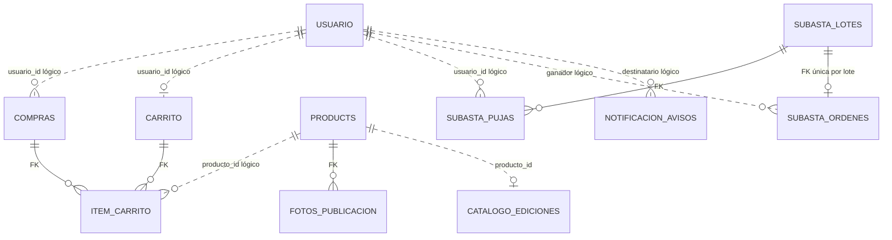

# Modelo de datos de VÉRTICE

PostgreSQL usa una base `ecommerce` y cuatro contextos. El recorrido de compra actualiza inventario y pedidos en la misma transacción de Catálogo. La relación por ID de usuario entre servicios se valida en aplicación.

`subasta_avisos` guarda publicaciones pendientes por clave de evento, mientras `notificaciones_pendientes` respalda el encolado de avisos y `sms_simulado` registra SMS simulados. Los índices principales de Subastas cubren estado y cierre, categoría y condición, pujas por lote y usuario, y órdenes por usuario.

La curaduría pública lee el motivo y la visibilidad desde los atributos JSON de `subasta_lotes`. Un lote interno conserva su enlace directo y sus relaciones con pujas, avisos y adjudicaciones. El script incluye el plan de consulta de la portada.

La marca `compras.requiere_pago_simulado` habilita el flujo en pedidos nuevos. `pago_simulado_en` registra la primera confirmación. En Subastas, `subasta_ordenes.pagada` conserva el instante equivalente. El número de referencia se forma con el tipo y el identificador de orden. Las dos tablas conservan sus relaciones existentes y el estado de envío de Catálogo permanece separado del pago.

Catálogo bloquea la fila de `catalogo_ediciones` al comprobar fecha y cupo por cliente. El inventario sigue en `products.stock`. Las compras y adjudicaciones conservan el instante del primer pago simulado. `products.estado_publicacion` controla la Tienda pública y permite conservar filas de pedidos anteriores.

[Consultas para inspeccionar PostgreSQL](vertice-inspeccion.sql) · [Claves foráneas inspeccionadas](../../resultados/vertice-datos.json)
